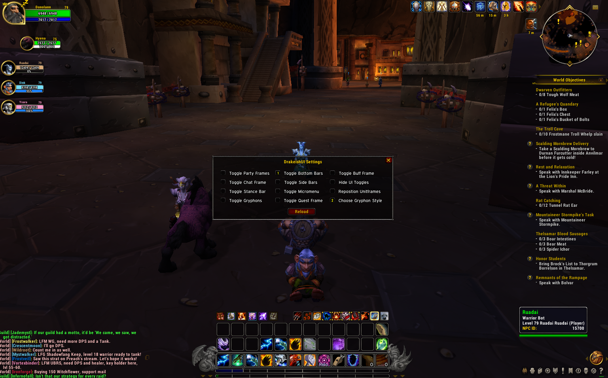

# DrakeishUI




## Description

DrakeishUI is a Dragonflight-style UI addon for World of Warcraft: Wrath of the Lich King (3.3.5). It provides a modern, clean interface that combines the best features from multiple great addons into one cohesive package.

## Features

### Core UI Components
- **Dragonflight-Style Unit Frames**: Modern player, target, and party frames with portrait support
- **Action Bars**: Customizable main action bars, sidebars, pet bar, and stance bar
- **Nameplates**: Kui Nameplates with three display modes (selected unit, all units, or native Blizzard plates)
- **Raid Frames**: Compact raid frames in two styles, with a shaded health fill
- **Chat System**: Enhanced chat with copy functionality
- **Minimap**: Custom border that turns with the map, north arrow, and a button toggle that stays on the ring
- **Castbar**: Styled casting bar for player and target
- **Buffs & Debuffs**: Custom buff/debuff display
- **Loss of Control Alerts**: Visual alerts for crowd control effects

### Additional Features
- **Mistra's Diablo Orbs**: Diablo-style health and mana orbs with customizable appearance
  - Health orb (always red) and mana orb (class-colored)
  - Pet orb with health display (positioned at bottom with main orbs)
  - Customizable textures, colors, and animations
  - Toggle pet orb visibility from UI settings
- **Custom Diablo Target Frame**: Replaces default target frame when Diablo orbs are active
  - Diablo-style textures and layout
  - Health bar color options (class colors for players, red/green for NPCs, red for bosses)
  - Classification indicators (boss, rare, elite)
  - Tooltip support matching normal target frame
  - No target castbar and no target buff/debuff frame in this mode(on purpose) to have more simple rpg feel
- **Bag Management**: Bagster bag system with filtering, search, and sort
- **Tooltips**: Enhanced item tooltips with additional information
- **Zone Information**: Cromulent integration for zone details
- **Durability Display**: Track your equipment durability
- **Experience Bar**: Custom experience bar styling
- **UI Toggles**: Settings window for frames, bars, gryphons, raid frames, nameplates, and minimap rotation
- **Talents, Spellbook, Character, Social, and World Map**: Modern window chrome on the main character and map panels
- **Grid System**: Visual grid overlay for UI alignment
- **Button Range Indicators**: Visual feedback for out-of-range abilities

## Installation

1. Download the latest release
2. Extract the `DrakeishUI` folder to your World of Warcraft `Interface\AddOns\` directory
3. The path should look like: `WoW\Interface\AddOns\DrakeishUI\`
4. Launch World of Warcraft and enable the addon in the character selection screen

## Requirements

- World of Warcraft: Wrath of the Lich King (3.3.5)
- Interface version: 30300

## Configuration

### In-Game Settings

The addon saves various UI states and settings. You can customize:
- Collapsible UI elements (buffs, bags, quest tracker, chat, party frames, etc.)
- Action bar visibility and positioning
- Unit frame styles and positions
- And much more!

### Supplementary Configuration Files

For advanced customization, you can modify the `config.lua` file in the root directory. This file contains detailed settings for:

- **Action Bars**: Scale settings for main bars, sidebars, and vehicle bar
- **Micromenu**: Scale and position settings for the micromenu and bags bar
- **Experience/Reputation Bars**: Offset configurations for XP and reputation bars
- **Style Options**: Choose between 'old' and 'new' styles for gryphons, XP bars, and bags
- **Button Customization**: 
  - Hotkey display and font settings
  - Macro text appearance
  - Cooldown text display
  - Button count positioning
  - Range indicator options
- **Additional Bars**: Settings for pet bar, stance bar, and vehicle bar positioning
- **Assets**: Paths to custom textures and icons

**Example from `config.lua`:**
```lua
mainbars = {
    scale_actionbar = 0.9,  -- Main action bar scale
    scale_rightbar = 0.9,    -- Right sidebar scale
    scale_leftbar = 0.9,     -- Left sidebar scale
},
```

### Module Activation/Deactivation

You can enable or disable specific modules by editing `modules/modules.xml`. Simply comment out (or remove) the lines for modules you don't want to use.

**To disable a module:**
- Comment out the line with `<!--` and `-->`

**Example - Disabling the Grid overlay:**
```xml
<!-- <Script file="grid.lua"/> -->
```

**Available modules you can enable/disable:**
- Action bars (mainbars, sidebars, petbar, stance, vehicle)
- Cooldowns display
- Chat enhancements
- Minimap modifications
- Buff/debuff display
- DragonflightUI modules (unit frames, castbar, party frames)
- Kui Nameplates
- Bagster bag system
- Loss of Control alerts
- Tooltips enhancements
- And more...

**Note:** Some modules have dependencies on others (especially libraries). Disable modules carefully to avoid errors.

## Changelog

See [CHANGELOG.md](CHANGELOG.md) for a detailed list of recent changes and updates.

## Version

**Current Version:** 2.0.0

## Author

**F@bagun**

## Credits

This addon is built upon the work of many talented developers:

- **DragonflightUI**: Yuritsuki
- **DragonUI**: NeticSoul
- **DragonUI New Era**: DragonUI_NewEra team
- **Classic API**: Tsoukie
- **Bagster/BagSort**: DragonUI (NeticSoul)
- **Loss of Control Alerts**: RomanSpector & Blizzard
- **Cromulent**: phyber (Cartographer_ZoneInfo: ckknight)
- **MoP Item Tooltips**: ZEUStiger
- **Mistra's Diablo Orbs**: John Rubin - "Mistra50" (originally from RothUI by "Zork")
- **Kui Nameplates**: Kesava (backported by bkader)
- **LibStub**: Kaelten, Cladhaire, ckknight, Mikk, Ammo, Nevcairiel
- **LibTourist-3.0**: ckknight, Arrowmaster (credits: Abydos)
- **LibBabble-Zone-3.0**: ckknight
- **UTF8**: Pastamancer
- **pretty_actionbar**: s0high

## License

This addon combines multiple open-source projects. Please refer to the individual module licenses for specific terms.

## Support

For issues, suggestions, or contributions, please visit the GitHub repository.

---

*Enjoy your new Dragonflight-style UI experience in Wrath of the Lich King!*

